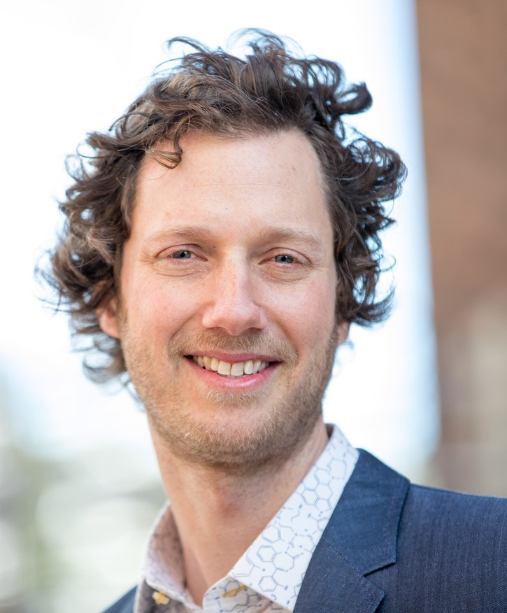

## Main contributors

PGEforge was supported by the following people, listed alphabetically.

+-----------------------------+-------------------------------------------------------------------------------------+----------------------------------------------------------------------------------------------------------------------------------------------------------------------------------------------------------------------------+
| Name                        |                                                                                     | Affiliations                                                                                                                                                                                                               |
+=============================+=====================================================================================+============================================================================================================================================================================================================================+
| #### Jorge Amaya-Romero     | {fig-align="left" width="100px"}                          | Immunology and Infectious Disease, Harvard T.H. Chan School of Public Health                                                                                                                                               |
+-----------------------------+-------------------------------------------------------------------------------------+----------------------------------------------------------------------------------------------------------------------------------------------------------------------------------------------------------------------------+
| #### Sophie Bérubé          | {fig-align="left" width="100px"}                        | Department of Epidemiology, Johns Hopkins Bloomberg School of Public Health                                                                                                                                                |
+-----------------------------+-------------------------------------------------------------------------------------+----------------------------------------------------------------------------------------------------------------------------------------------------------------------------------------------------------------------------+
| #### Nick Brazeau           | {fig-align="left" width="100px"}                      | PGY-1, Internal Medicine, Duke University Medical Center                                                                                                                                                                   |
+-----------------------------+-------------------------------------------------------------------------------------+----------------------------------------------------------------------------------------------------------------------------------------------------------------------------------------------------------------------------+
| #### Mouhamadou Fadel Diop  | {fig-align="left" width="126"}                            | Medical Research Council Unit The Gambia at the London School of Hygiene and Tropical Medicine                                                                                                                             |
+-----------------------------+-------------------------------------------------------------------------------------+----------------------------------------------------------------------------------------------------------------------------------------------------------------------------------------------------------------------------+
| #### Bryan Greenhouse       | {fig-align="left" width="100px"} | EPPIcenter, University of California San Francisco                                                                                                                                                                         |
+-----------------------------+-------------------------------------------------------------------------------------+----------------------------------------------------------------------------------------------------------------------------------------------------------------------------------------------------------------------------+
| #### Zoe Gotthold           | {fig-align="left" width="100px"}                    | National Institute of Allergy and Infectious Disease, National Institutes of Health, Bethesda, MD                                                                                                                          |
+-----------------------------+-------------------------------------------------------------------------------------+----------------------------------------------------------------------------------------------------------------------------------------------------------------------------------------------------------------------------+
| #### Bing Guo               | {fig-align="left" width="100px"}                        | Center for Vaccine Development and Global Health, University of Maryland School of Medicine, Baltimore, MD, USA                                                                                                            |
+-----------------------------+-------------------------------------------------------------------------------------+----------------------------------------------------------------------------------------------------------------------------------------------------------------------------------------------------------------------------+
| #### Nicholas Hathaway      | {fig-align="left" width="100px"}      | Department of Medicine, University of Massachusetts Chan Medical School                                                                                                                                                    |
+-----------------------------+-------------------------------------------------------------------------------------+----------------------------------------------------------------------------------------------------------------------------------------------------------------------------------------------------------------------------+
| #### Jason Hendry           | {fig-align="left" width="100px"}                          | Max Planck Institute for Infection Biology                                                                                                                                                                                 |
+-----------------------------+-------------------------------------------------------------------------------------+----------------------------------------------------------------------------------------------------------------------------------------------------------------------------------------------------------------------------+
| #### Alfred Hubbard         | {fig-align="left" width="100px"}                  | Department of Epidemiology, Johns Hopkins Bloomberg School of Public Health, USA                                                                                                                                           |
+-----------------------------+-------------------------------------------------------------------------------------+----------------------------------------------------------------------------------------------------------------------------------------------------------------------------------------------------------------------------+
| #### Kirsty McCann          | {fig-align="left" width="100px"}                    | Centre for Innovation in Infectious Disease and Immunology Research (CIIDIR) The Institute for Mental and Physical Health and Clinical Translation (IMPACT), School of Medicine, Deakin University                         |
+-----------------------------+-------------------------------------------------------------------------------------+----------------------------------------------------------------------------------------------------------------------------------------------------------------------------------------------------------------------------+
| #### Kathryn Murie          | {fig-align="left" width="100px"}                        | EPPIcenter, University of California San Francisco                                                                                                                                                                         |
+-----------------------------+-------------------------------------------------------------------------------------+----------------------------------------------------------------------------------------------------------------------------------------------------------------------------------------------------------------------------+
| #### Max Murphy             | {fig-align="left" width="100px"}                            | EPPIcenter, University of California San Francisco                                                                                                                                                                         |
+-----------------------------+-------------------------------------------------------------------------------------+----------------------------------------------------------------------------------------------------------------------------------------------------------------------------------------------------------------------------+
| #### Bassirou Ngam          |                                                                                     | Centre International de Recherche et de Formation en Génomique Appliquée et de Surveillance Sanitaire (CIGASS), Dakar, Sénégal                                                                                             |
+-----------------------------+-------------------------------------------------------------------------------------+----------------------------------------------------------------------------------------------------------------------------------------------------------------------------------------------------------------------------+
| #### Karamoko Niare         | {fig-align="left" width="100px"}                 | Brown University                                                                                                                                                                                                           |
+-----------------------------+-------------------------------------------------------------------------------------+----------------------------------------------------------------------------------------------------------------------------------------------------------------------------------------------------------------------------+
| #### Josphat Nyataya        |                                                                                     | Kenya Medical Research Institute (KEMRI)/Walter Reed Army Institute of Research-Africa, Basic Science Laboratory, Kisumu Field Station, Kisumu, Kenya                                                                      |
+-----------------------------+-------------------------------------------------------------------------------------+----------------------------------------------------------------------------------------------------------------------------------------------------------------------------------------------------------------------------+
| #### Jody Phelan            | {fig-align="left" width="100px"}                           | London School of Hygiene and Tropical Medicine                                                                                                                                                                             |
+-----------------------------+-------------------------------------------------------------------------------------+----------------------------------------------------------------------------------------------------------------------------------------------------------------------------------------------------------------------------+
| #### Shazia Ruybal-Pesántez | {fig-align="left" width="98"}                             | MRC Centre for Global Infectious Disease Analysis, Department of Infectious Disease Epidemiology, Imperial College London; Instituto de Microbiología, Universidad San Francisco de Quito                                  |
+-----------------------------+-------------------------------------------------------------------------------------+----------------------------------------------------------------------------------------------------------------------------------------------------------------------------------------------------------------------------+
| #### Stephen F. Schaffner   | {fig-align="left" width="100px"}                 | Broad Institute of Harvard and MIT; Department of Organismic and Evolutionary Biology, Harvard University; Department of Immunology and Infectious Diseases, Harvard T.H. Chan School of Public Health, Harvard University |
+-----------------------------+-------------------------------------------------------------------------------------+----------------------------------------------------------------------------------------------------------------------------------------------------------------------------------------------------------------------------+
| #### Alfred Simkin          | {fig-align="left" width="100px"}                         | Pathology and Laboratory Medicine, Brown University                                                                                                                                                                        |
+-----------------------------+-------------------------------------------------------------------------------------+----------------------------------------------------------------------------------------------------------------------------------------------------------------------------------------------------------------------------+
| #### Aimee Taylor           | {fig-align="left" width="108"}                          | Institut Pasteur                                                                                                                                                                                                           |
+-----------------------------+-------------------------------------------------------------------------------------+----------------------------------------------------------------------------------------------------------------------------------------------------------------------------------------------------------------------------+
| #### Bob Verity             | {fig-align="left" width="100px"}                            | MRC Centre for Global Infectious Disease Analysis, Department of Infectious Disease Epidemiology, Imperial College London                                                                                                  |
+-----------------------------+-------------------------------------------------------------------------------------+----------------------------------------------------------------------------------------------------------------------------------------------------------------------------------------------------------------------------+
| #### Amy Wesolowski         | {fig-align="left" width="100px"}                      | Department of Epidemiology, Johns Hopkins Bloomberg School of Public Health                                                                                                                                                |
+-----------------------------+-------------------------------------------------------------------------------------+----------------------------------------------------------------------------------------------------------------------------------------------------------------------------------------------------------------------------+

## Community rules

All contributors to PGEforge adhere to our [community rules](how_to_contribute.qmd#community-rules).
