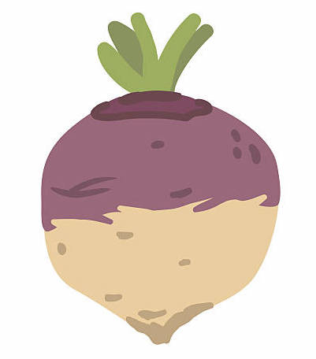
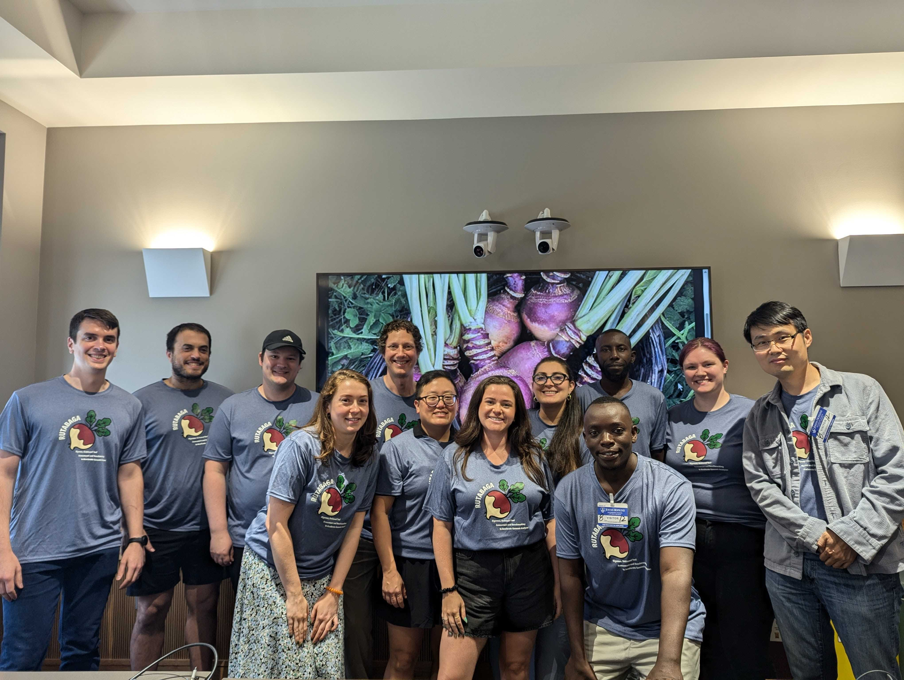

## Background

The **R**igorous, **U**nbiased **T**ool **A**ssessment and **B**enchmarking to **A**ccelerate **G**enomic **A**nalysis Hackathon (**Rutabaga25**), organised by Alfred Hubbard, Kathryn Murie, Amy Wesolowski and Bryan Greenhouse took place at Johns Hopkins Bloomberg School of Public Health in Baltimore, USA from 11-15th August 2025, with 12 participants from 8 institutions.

::: {.column-margin}
{ width=176 height=200 }
:::

*For more details on Rutabaga25 attendees and contributors to PGEforge, see the [Contributors page](contributors.qmd)*

## Main aims

Our aim was to do the initial benchmarking of tools for *Plasmodium* genomic analysis. Each person was assigned a tool. They used pre-generated simulated datasets to evaluate that tool with a shared template, and presented the results back to the group.

## Outputs

Participants produced a first set of tool evaluations on the simulated datasets and presented those results to the group. Those evaluations are on the [benchmarking page](https://mrc-ide.github.io/PGEforge/website_docs/benchmarking.html).
